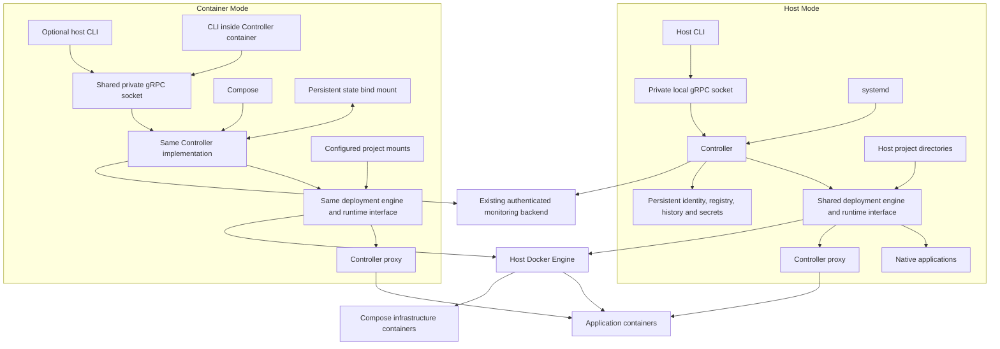

# Host and container Controller modes

## Phase 0 audit

Audited on November 22, 2026, on branch `docker`, starting at `cde3fb7`.
Existing changes to the environment command, configuration, environment guide,
and untracked local files are outside this work. No deployment engine will be
replaced. The phase record below distinguishes existing support from changes
needed for a supported distribution.

## Current execution paths

| Responsibility | Current implementation and behavior |
| --- | --- |
| Command entry | `main.go` builds one Cobra command tree. `cmd.RouteControl` replaces management handlers with the local API client. The private Controller adapter retains the existing handlers. |
| Local API | `internal/controlapi/proto/control.proto` defines the versioned `phelix.control.v1` gRPC service. `cmd/control_service.go` validates requests, queries state, and supervises command adapters. |
| Controller | `cmd/controller.go` loads configuration, validates container mounts, acquires ownership, starts the proxy, and enters `runMonitorContext`. `monitor` remains a compatibility entry point. |
| Ownership | `internal/controller/owner_unix.go` locks `controller.lock` on persistent state with `flock`. Adapters inherit the lease, so ownership cannot be reused before they exit. Independent state directories deliberately have independent identities. |
| Identity | `internal/server/server.go` persists a random Agent ID in `agent-id`. Server ID aliases the Agent ID for existing backend contracts. Container hostname does not determine identity. |
| Storage | Registry, deployment journals, versions, secrets, sessions, logs, and operation records use `PHELIX_DATA_DIR`. The default is the existing user's `.phelix` directory on the host and `/var/lib/phelix` inside Docker. |
| Secrets | `internal/env` and `internal/secrets` preserve the master key and encrypted values. `internal/controller/storage.go` copies legacy keys and sessions without overwriting conflicting stores. It is not a full host-to-container migration. |
| Builds | `cmd/rebuild_docker.go` resolves Dockerfile or Compose inputs. `internal/docker/build.go` invokes the Docker CLI with context cancellation and streams build output. The build context must exist inside the Controller. |
| Native applications | `internal/app/process.go` and the deploy process launcher run and verify native processes. Host Mode does not require Docker for native applications. |
| Docker applications | `internal/deploy/docker_launcher.go` invokes the host Engine through the Docker CLI. Instances carry container ID, recorded host PID, endpoint, slot, and version. Ownership labels protect other installations' containers. |
| Runtime endpoints | `internal/deploy/endpoint.go` uses host loopback plus an ephemeral published port in Host Mode, and the exact container IP on the configured network in Container Mode. |
| Strategies | `bluegreen.go`, `rolling.go`, and `rollout.go` share build sources, launchers, health checks, proxy targets, secret transactions, and version promotion. Canary and progressive use weighted blue-green targets. |
| Proxy and health | `internal/proxy/control.go`, `proxy.go`, and `internal/health/tiered.go` consume explicit endpoints. Candidates are checked before promotion. Application containers have no shared network alias. |
| Rollback and recovery | `internal/deploy/rollback.go`, `lifecycle.go`, and the monitor restore paths reuse runtime-aware launchers. Startup refreshes endpoints, restores routes and log drains, and reconciles interrupted scale and secret work. |
| Operations | `internal/controlapi/operations.go` persists operation IDs and results, runs bounded concurrent adapters, and records unfinished operations as interrupted after restart. Progress replay is bounded in memory. |
| Monitoring | `internal/grpc` retains the authenticated outbound backend protocol. It is separate from the local API. Docker metrics use Engine statistics; native metrics use processes. |
| Installation | `install.sh` downloads published binaries and starts the foreground Controller through systemd. It has no container installation option. |
| Distribution | `Dockerfile.controller` builds a local image. The release workflow publishes CLI artifacts only. Existing image examples require a repository checkout and local image build. |

## Final architecture to preserve

The CLI remains an API client in both modes, including container `exec` calls.
The Controller runs existing command handlers in private child adapters because
those handlers use process-global flags, working directories, and output. The
private adapter checks its parent, inherited socket, persistent lock descriptor,
and identity before executing a request. This keeps one management boundary
without duplicating deployment logic or racing command globals in the daemon.

## Required changes by phase

| Phase | Existing support | Work required and validation |
| --- | --- | --- |
| 0 | Existing architecture notes | This source audit, constraints, migration design, and diagrams. |
| 1 | Shared lifecycle, persistent ownership and identity | Check startup and cleanup errors, container-native restrictions, graceful shutdown, and restart behavior. |
| 2 | Dedicated local API and structured operations | Check socket security, cancellation, request limits, shutdown, readiness, and compatibility. Retain the current protobuf contract. |
| 3 | Management commands already routed through the API | Automatic installed socket discovery, useful connection errors, output preservation, and both CLI entry paths. |
| 4 | Source mapping and Docker build contexts | Validate normalization, overlapping roots, symlink escapes, read-only preparation, and actual mounted builds. |
| 5 | Runtime-aware endpoints and Docker metrics | Validate both topologies, every supported strategy, health, routing, rollback, and endpoint recovery. |
| 6 | Local multi-stage Dockerfile | Official versioned image, release metadata, default Container Mode, image health check, release workflow and architecture validation. |
| 7 | Host installer | Container option, optional host CLI, generated Compose/configuration, safe prerequisites and repeat installation, and migration guidance. |
| 8 | Existing recovery journals | Supported image upgrade and backup workflow, interrupted operations, stale sockets, recreation and identity preservation. |
| 9 | Runnable development examples | Published-image paths, complete installation and operational documentation, and standalone example archives. |
| 10 | Unit and integration coverage | Full suite, race checks, actual Docker deployments and recovery, architecture results, final report and manual PR draft. |

Each phase must be validated and recorded before the next begins. Existing
working behavior will receive regression checks rather than a parallel rewrite.

## Constraints and compatible decisions

### Controller process and native applications

An ordinary bridge-networked container cannot supervise existing host-native
processes or use their loopback endpoints. The current image has no application
compilers. Container Mode will support Docker application execution; existing
native applications retain Host Mode. A native deployment must receive a clear
error in Container Mode instead of silently starting inside the Controller.
No host PID namespace or privileged-container workaround will be introduced.
This preserves the shared runtime interface with a mode-specific capability
restriction, consistent with the request's requirement not to claim unvalidated
native container support.

### Installer interpreter

The existing installer uses Bash arrays, regular expressions, and other Bash
features. Its supported invocation will remain `curl ... | bash`, including
`bash -s -- --docker`. The proposed `sh` example is incompatible with the
existing script. Rewriting the host installer into POSIX shell would add an
unrelated compatibility risk.

### Persistent paths and migration

Saved application directories and environment snapshot paths can be absolute.
Migration must preserve their visible paths, the complete state directory,
encryption keys, identity, and all journals. A safe manual migration can bind the
state and project directories at their existing absolute paths inside the
Controller. Fresh installations may use configurable defaults.

Container installation must refuse to replace an active host service or silently
adopt an existing state directory. The supported migration workflow will stop
conflicting ownership, back up the complete store, inspect native applications
and active operations, prepare matching source and network mounts, verify the
new Controller, and retain the original backup and executable for rollback.
Existing Docker application containers must not be removed during migration.
Multiple existing application networks require explicit preparation; one shared
Controller network is the supported default topology.

### Docker access and networking

The Controller uses the host Docker socket. Docker-in-Docker, a public Engine
TCP listener, and privileged mode are unnecessary. Socket access still grants
administrative power over the Docker host, including with a read-only bind.
The supplied image can use root to manage socket ownership and local state;
non-root operation requires suitable numeric IDs and directory/socket permissions.

The Controller and managed containers share a configured user-defined network.
Proxy and health targets use exact container endpoints. Compose may publish
only requested proxy ports or provide an existing gateway. New public ports may
require Controller container recreation. Controller restart interrupts its
in-process proxy while applications can remain running. Controller upgrades
will not be described as zero downtime.

### Release and architecture policy

Image name: `ghcr.io/abdorrahmani/phelix`. CLI and image versions must come from
the same validated release tag and revision. Stable releases may update `latest`;
beta releases must not update it. No major/minor alias is required by the current
release convention. Docker tags cannot contain SemVer `+` metadata, so the image
tag must encode that suffix consistently while preserving the original version
in the executable and OCI labels.

The image must build from committed source, including production configuration,
and must not depend on a locally staged binary. Linux amd64 is available here.
Arm64 publishing must be gated by its own successful image, executable, startup,
and health validation. Other existing CLI platforms retain their current binary
release support; they do not automatically become supported Controller images.
No image or release will be published during implementation.

## Security and recovery requirements

The local API retains Unix peer authentication and restrictive filesystem
permissions. It has no public network listener. Source access is limited to
configured roots with resolved symlink checks. Persistent state and encrypted
credentials remain outside the image. Docker build output continues to use
existing secret redaction. State backups must be taken after stopping the
Controller or otherwise making a consistent snapshot; restoring an older image
must use a compatible pre-upgrade backup if state has changed.

Recovery acceptance includes preserved identity and registry, restored proxy
routes, accurate Docker status and metrics, interrupted operation reporting,
and safe rollback of app versions. Host reboot and daemon restart tests must
use dedicated infrastructure and cannot interrupt the user's running services.
Unavailable infrastructure or architectures will be explicitly recorded rather
than inferred from mock tests.

## Phase record

Phase 0: source audit complete. Baseline tests and subsequent phase results will
be recorded alongside their commits in the final work report.
