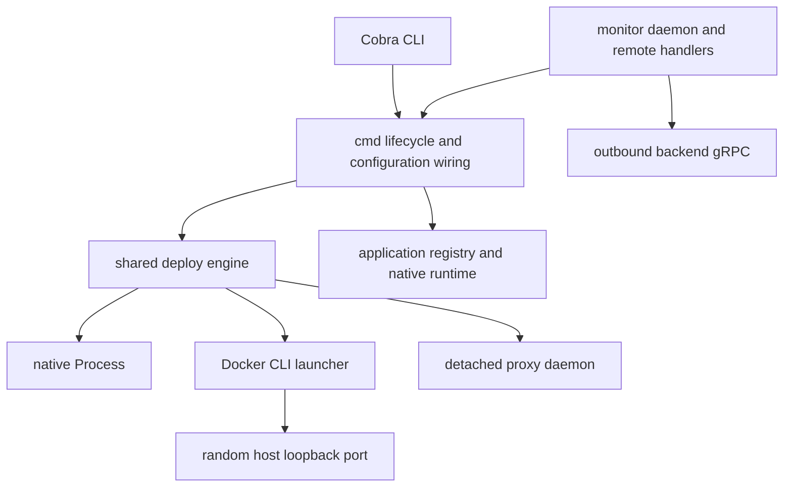
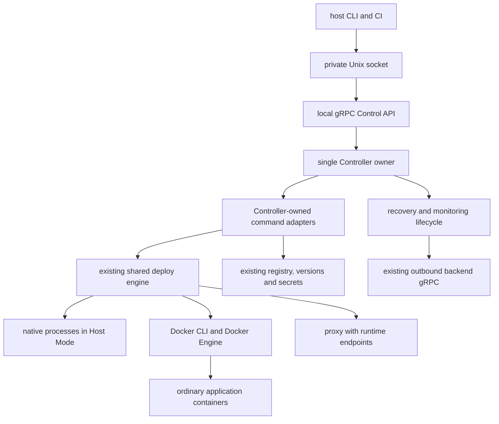

# Docker Controller architecture

## Audit, 2026-11-17

The audit used source code, not the existing Docker guide. The starting branch
is `docker`. Pre-existing changes to config/config.yml and untracked user files
are outside this change. No state or user changes may be discarded.

The executable constructs Cobra commands in main.go. cmd/build.go registers
applications, builds and starts native processes; its Docker path delegates to
cmd/rebuild_docker.go and runZeroDowntimeDeploy. cmd/rebuild.go and
cmd/rebuild_spec.go resolve source, configuration, secrets, hooks and strategy.
start, stop, restart, remove, rollback, scale, worker/job, workspace, matrix,
plan apply, secrets apply, watch, health and proxy commands contain additional
management paths. Backend and webhook handlers sometimes invoke the executable
through internal/monitor/subprocess.go. They must also enter the Controller API.

internal/deploy is already the shared orchestration engine. BlueGreen, Rolling
and Rollout use BuildSource and InstanceLauncher. Canary and progressive use
the blue-green topology and weighted proxy targets. DockerBuildSource records
images with the existing two-phase version promotion and encrypted environment
snapshots. DockerVersionSource provides rollback images. These flows must be
preserved, including secret transactions, hooks, retiring instances and recovery
journals. Docker uses argument arrays through exec.CommandContext, not an SDK.

internal/deploy/docker_launcher.go returns Process and an integer port. It
publishes 8080 to a random 127.0.0.1 host port. Health checks, proxy targets,
rollback verification, rolling membership, scale and rollout verification turn
that integer back into a loopback address. This fails inside a bridge-network
Controller. Internal proxy.Target already supports an arbitrary host:port.

Container liveness uses container IDs and managed labels instead of host PIDs.
Existing orphan cleanup filters by managed/app labels but does not distinguish
installations. Existing shutdown verifies only the managed label. Installation
ownership must be added without adopting unreferenced legacy containers.

cmd/monitor.go combines recovery, health, worker/job/security/autoscale schedulers
and the remote backend connection. Recovery skips an already live deployment,
which can leave proxy routes absent after container recreation. Recovery must
restore routing even when the application container remains alive.

internal/grpc is an outbound authenticated backend connection with remote
command ledgers, metadata, health, deployment telemetry, metrics and logs. Its
protobufs and lifecycle are separate from the new local management service.
internal/server supplies host metrics and agent identity, not a local server.
ServerID deliberately aliases AgentID. App IDs live in the existing apps.json.
Application containers do not initialize any Phelix identity.

The registry, deploy state, health state, proxy state, secret store and most
operational ledgers honor PHELIX_DATA_DIR. internal/env and cmd/auth/session.go
still use HOME/.phelix for keys, encrypted environments and backend sessions.
Moving to a data volume must retain these files and must fail on conflicting
keys instead of creating a replacement key. Configuration embeds config.yml
with backend environment overrides; project configuration is phelix.yaml.
Controller configuration must be separate from both and loaded before service
initialization.

internal/project validates configuration and owns strategy/runtime resolution.
internal/matrix builds independent combinations and retains history; workspace
and plan execution reuse the existing command services. internal/logs performs
secret redaction and detached native/Docker log drains. internal/secrets owns
encrypted values, committed bindings and execution coverage. Monitoring currently
mostly samples processes, so Docker metrics need Engine-based sampling.

install.sh installs a foreground `phelix monitor` systemd service with
KillMode=process. That preserves native applications across service restart.
The compatibility alias must start the unified Controller, with its lock and
local API, rather than a second independent manager. Existing examples use
Compose for infrastructure and Phelix for application deployments.

## Current architecture

## Target architecture

## Orchestration boundary

Cobra handlers currently rely on process-global flags, current working directory,
stdout and singletons. Executing those handlers concurrently in the Controller
process would race configuration, output and registry mutation. Moving every
handler and test or writing another deployment engine is unnecessary.

The Controller will use private, supervised command adapters in child processes
of the same executable. A private inherited descriptor carries the request;
there is no public worker command or environment switch. The host CLI exclusively
calls the API. The Controller accepts, records, supervises and waits for each
operation and owns the host-level lock throughout. Adapters reuse exactly the
existing handlers and their deploy locks. They cannot start another Controller.
Independent applications can execute concurrently without sharing Cobra globals
or process working directories. Existing atomic registry merging and per-app
OS locks remain authoritative. Backend subprocess commands enter the API too.

The parent initializes identity, registry and recovery services and owns the
proxy/monitor lifecycle. Application processes and containers survive Controller
shutdown; active requests settle before ownership is released. Long-running
operations have durable IDs, bounded progress, terminal results and explicit
cancellation capability. Cancellation must signal the adapter and let deployment
cleanup run; forced termination of a mutating adapter is not a successful cancel.
Interrupted operations are recorded as interrupted on startup and existing
engine journals are recovered before new mutations.

## Local API contracts and transport

Use a separate internal/controlapi protobuf package and generated service.
Expose Health, Info, Applications, Status, Runtime, Metrics, Versions, History,
Execute, Operation, WatchOperation and CancelOperation. Public messages contain
explicit fields, enums and errors, never deployment structs or plaintext secrets.
The management request carries a validated command path, arguments, named
options and source path so existing CLI flags remain available without another
set of business rules. Only an allowlisted management command tree is accepted.
Non-management developer helpers stay local and are documented explicitly.

Use a configurable absolute Unix socket, defaulting to the data directory.
Protect the parent directory and socket. On Linux authenticate SO_PEERCRED;
allow the Controller UID and explicitly configured UID, with UID 0 considered
administrative. Container users map the permitted host UID explicitly. Do not
open TCP. Refuse to unlink regular files or a live socket. Use bounded messages,
validation, deadlines, structured redacted errors and streaming reconnect by
sequence number. No operation may be reported successful before completion.

## Networking and runtime endpoint design

Keep InstanceLauncher and Process. Add an optional process endpoint method and
an additive persisted Instance endpoint. Native and Host Mode Docker use
127.0.0.1:port. Container Mode uses a configured shared user-defined bridge
network and inspect resolves the exact container IP plus port 8080. Do not
publish application ports in Container Mode and do not add shared network
aliases. The Controller proxy ports are published by Compose explicitly.

All health probes, traffic targets, verification, membership reconstruction and
rollback must consume the endpoint. Recovery inspects current Docker metadata,
refreshes endpoints, restores routes and handles recreated containers by recorded
identity rather than names. Controller and managed containers must share the
configured network; a missing or incompatible network fails startup/deploy.

Add phelix.controller and stable phelix.app-id ownership labels alongside existing
managed/app/slot labels. Only referenced legacy containers may be adopted after
checking app label and full ID against persisted state. Orphan cleanup must
filter by Controller ownership and verify metadata immediately before removal.
Other installations and unmanaged containers are left untouched.

## Identity, storage and upgrades

One exclusive OS file lock in the persistent data directory protects the fleet.
Keep the lock file inode, never use PID-file deletion as lock recovery. The
kernel releases the lock when its owner dies. Bind mounts and volumes must retain
the same directory and support local flock semantics; network filesystems are
not supported for Controller state.

No new identity format or registry is needed. AgentID and ServerID stay stable.
New endpoint/ownership fields are additive; missing fields mean legacy behavior.
Copy legacy keys, encrypted env stores and sessions to the configured directory
with atomic writes, conflict checks and a repeatable migration. Preserve originals.
Do not merge different installations automatically. Moving the fleet to another
path requires copying the complete state with the Controller stopped.

Source paths must exist inside the Controller. Container examples use an explicit
host-to-Controller workspace mount mapping; source paths are canonicalized and
restricted to configured roots, including symlink traversal. Do not mount the
entire host. Build temporary files use existing build/source lifecycle cleanup.

## Scope map

Create internal/controller for ownership/configuration, internal/controlapi for
contracts/transport/client, cmd/controller.go and cmd/control_client.go for wiring,
Controller Dockerfile, controller tests and both requested examples.

Modify main.go command dispatch and cancellation; cmd/monitor.go lifecycle and
recovery; lifecycle/build/rollback command context propagation where needed;
internal/deploy endpoint construction, health, rolling/rollout/rollback/scale,
Docker labels/recovery; internal/env and auth storage resolution;
internal/docker build cancellation and stream synchronization;
internal/monitor and autoscale runtime sampling; install.sh service command;
architecture, installation and Docker documentation.

Keep backend protobuf contracts and authentication protocol, application config
runtime/strategy vocabulary, native process launcher behavior, encrypted formats,
version format and deployment algorithms unchanged. Do not change infrastructure
ownership, add a Docker SDK, Kubernetes, dashboard or public management endpoint.

## Validation and phases

Each completed phase is tested, reviewed and committed locally. No push.

0. Audit and this design. Baseline relevant package tests.
1. Ownership, lifecycle, persistent configuration and repeatable storage upgrade.
   Test competing owners, release, restart, damaged state and identity retention.
2. Protobuf service, authenticated socket, durable operations, client and streams.
   Test permissions, requests, cancellation, concurrency, replay, cleanup/reconnect.
3. Route the complete management command tree to the API and supervise adapters.
   Test command routing and real CLI errors, flags, output, cancellation and state.
4. Add endpoints across the shared runtime and strengthen Docker ownership.
   Test native/host/bridge endpoints, probes, membership and every strategy.
5. Package Controller image and explicit mounts/network topology. Validate image,
   live Docker deployment, proxy reachability, restart and recreation.
6. Engine metrics and runtime logs integrated with local API and existing backend.
   Test stats parsing, missing containers, daemon failure and monitoring behavior.
7. Complete Host and Container examples and operational documentation.
8. Full unit/race/vet/build and isolated real Docker lifecycle tests, unrelated
   container protection, restart/recovery and runnable example checks.

Real Docker tests use isolated networks, state and uniquely labelled resources.
Record exact executed commands and failures. A skip is never a pass. Final report
must separate implemented behavior from unresolved issues and untested behavior.
